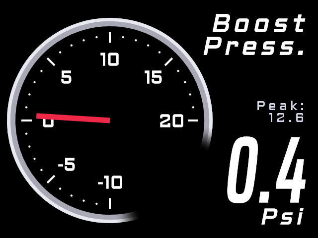
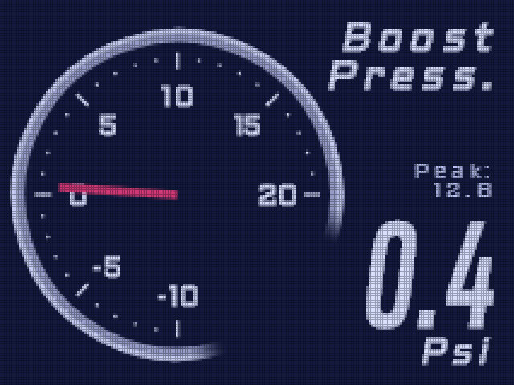

# GaugeDotnet

Real-time automotive gauge display for the [RG35XX](https://anbernic.com) handheld (ARM64 Linux). Connects via BLE to a Motorsports Electronics ECU, decodes CAN bus frames, and renders live gauges with SkiaSharp on SDL2 + OpenGL ES 2.0.

  

## Features

- Live gauge rendering at 60 fps via SDL2 + OpenGL ES 2.0
- BLE connection to Motorsports Electronics ECU (CAN bus frames ME1_1–ME1_8)
- Multiple built-in gauge styles: circular, sweep, needle, TurboXs, bar, digital, histogram, min/max, grid
- **Custom gauge designer** — drag-and-drop desktop app that exports JSON definitions for the device. The Rust designer (`rust/gauge-designer`) previews with the renderer the device runs, pixel for pixel; the original Avalonia designer still works
- 17 custom element types: arcs, zone arcs, needles (with image support), text, value displays, label+value boxes, tick rings, bars, warning indicators, images, value-driven gifs, clocks, mini graphs, peak markers, and more
- **Calculated channels** — define virtual data sources as math expressions (`Rpm / 1000`, `OilTemp - Iat`) evaluated each frame
- **Conditional element visibility** — show/hide elements based on a data source value range
- **Grid snap** in designer (G key toggle, 10 px grid); **multi-select** with Shift+click for group drag/delete; **drag corner handles** to resize the selected element
- Arc elements support anti-clockwise fill direction
- Smooth value interpolation (lerp) for fluid needle/arc/bar animation
- Simulated device mode for desktop development (`SimulatedMeDevice` in DEBUG builds)

## Projects

| Project | Purpose |
|---------|---------|
| `GaugeDotnet` | Main app — SDL2 window, gauge rendering, BLE connection |
| `GaugeDotnet.Designer` | Avalonia 12 drag-and-drop gauge designer (desktop, the original) |
| `ME1_4NET` | CAN bus decoder library (Motorsports Electronics frames ME1_1–ME1_8) |
| `ME1_4NET.Tests` | xUnit tests for CAN frame decoding |
| `RG35XX.Core` | Platform abstractions (gamepad, storage interfaces) |
| `RG35XX.Libraries` | Linux implementations (joystick, keyboard, storage) |
| `rust/` | Rust port of the renderer (custom + built-in gauges, tiny-skia, optional SDL2 window) and the Rust gauge designer — see [rust/README.md](rust/README.md) |

## Prerequisites

- [.NET 10 SDK](https://dotnet.microsoft.com/download)
- SDL2 development libraries (`libsdl2-dev` on Debian/Ubuntu)
- A GitHub PAT with `read:packages` scope (for the `VaettirNet.Btleplug` NuGet package)

## Setup

The `VaettirNet.Btleplug` BLE library is sourced from GitHub Packages. Set the PAT before restoring:

```shell
export GITHUB_PACKAGES_PAT=ghp_your_token_here
dotnet restore
```

See [nuget.config](nuget.config) for the package source configuration.

## Build & Run

```shell
dotnet build                                    # Build all projects
dotnet test                                     # Run xUnit tests
dotnet run --project src/GaugeDotnet            # Run app (SimulatedMeDevice in DEBUG)
dotnet run --project src/GaugeDotnet.Designer   # Open the Avalonia gauge designer
(cd rust && cargo run --release -p gauge-designer)   # Open the Rust gauge designer
```

### Deploy to Device

```shell
./deploy-arm64.sh
```

Publishes a self-contained linux-arm64 binary and SCPs it to the RG35XX. It also uploads the artwork muOS shows in the Ports list (box art, preview and description from [`muos/`](muos/README.md)).

The launcher, `GaugeDotnet.sh`, holds the Mali GPU at its top clock while the app runs and restores the previous floor on exit. The default `simple_ondemand` governor never raises the clock for the app, and frames take 20–40% longer at the bottom step (see `bench/RESULTS.md`).

## Architecture

```
┌─────────────────────────────────────────────┐
│                  GameLoop                    │
│  ┌──────────┐  ┌──────────┐  ┌───────────┐ │
│  │ GaugeSDL │  │InputHandler│ │ FpsCounter│ │
│  │ SDL2+GL  │  │ Gamepad+KB │ │           │ │
│  └────┬─────┘  └───────────┘  └───────────┘ │
│       │                                      │
│  ┌────▼──────────────────────────────────┐   │
│  │           BaseGauge / CustomGauge     │   │
│  │  ┌─────────────────────────────────┐  │   │
│  │  │      ElementRenderer (Skia)     │  │   │
│  │  └─────────────────────────────────┘  │   │
│  └───────────────────────────────────────┘   │
│       │                                      │
│  ┌────▼─────┐  ┌──────────────────────────┐ │
│  │ IMeDevice│  │      CanDecoder          │ │
│  │ BLE/Sim  │  │  ME1_1..ME1_8 → MEData  │ │
│  └──────────┘  └──────────────────────────┘ │
└─────────────────────────────────────────────┘
```

- **GaugeSDL** creates the SDL2 window with OpenGL ES 2.0 and wraps it with a SkiaSharp `GRContext`/`SKSurface`
- **BaseGauge** subclasses use a static cache pattern: inactive segments drawn once to bitmap, active segments redrawn per-frame
- **MeDevice** / **SimulatedMeDevice** implement `IMeDevice` — `#if DEBUG` uses the simulated device to bypass BLE
- **CanDecoder** dispatches CAN frames by PID to typed structs; `MEData` aggregates all decoded values

## TurboXs Gauge

`"Type": "TurboXs"` is a handheld-style analog + digital display that works for any data source: a 270° dial on the left (`MinValue` at 6 o'clock, sweeping clockwise to `MaxValue` at 3 o'clock) and a large italic readout on the right.

- **Scale:** 4 to 8 major ticks, chosen so every label is a round number (−10…20 → steps of 5, 0…8000 → 2000, 40…140 → 20).
- **Title:** one word per line, so `"Boost Press."` becomes two lines. `Unit` goes under the readout.
- **Fitting:** long titles, values and labels shrink to fit, so 4-digit RPM readings stay clear of the dial. The readout (and Peak/Min) is sized for the widest value in `MinValue`–`MaxValue`, with fixed-width digits, so it keeps one size and position as the value changes.
- **Status block** (under the title):

  | Setting | Values | Default |
  |---|---|---|
  | `StatusMode` | `Peak` (highest value seen), `Min` (lowest), `Text` (fixed text with a blue dot), `None` | `Peak` |
  | `StatusLabel` | First line | `Peak:`, `Min:` or `Datalog:` (by mode) |
  | `StatusText` | Second line in `Text` mode | `Stop` |

  Peak and Min start at the first reading. R1 resets them, as on the other gauges. `StatusMode` can also be changed in the on-device config editor.
- **Old LCD look:** `"Lcd": true` imitates a backlit handheld LCD. The gauge renders at a third of the resolution with a faint pixel grid, black becomes a deep navy and white a slightly blue white, and moving parts leave a short trail. `LcdGhosting` sets how much of the previous frame lingers: 0 turns the trail off, and the maximum is 0.9 (default 0.2). Both can be changed in the on-device config editor. C# draws it in one GPU shader pass on the device and uses lookup tables on a CPU canvas, as Rust does. It costs about 0.4 ms per frame over the normal look in Rust and 2 ms in C# on a CPU canvas (see `bench/RESULTS.md`).
- **Colours and fonts:** `ColorHex` is ignored, because the dial has a fixed white, grey and red palette. Text uses the bundled Aldrich and Saira Extra Condensed fonts (SIL OFL 1.1, licenses in `src/GaugeDotnet/fonts`), which are also available to custom gauges.

```json
{ "Gauge": { "Type": "TurboXs", "DataSource": "Map", "Title": "Boost Press.", "Unit": "Psi", "MinValue": -10, "MaxValue": 20, "Decimals": 1 } }
{ "Gauge": { "Type": "TurboXs", "DataSource": "Rpm", "Title": "Engine Speed", "Unit": "RPM", "MaxValue": 8000 } }
{ "Gauge": { "Type": "TurboXs", "DataSource": "Map", "Title": "Boost Press.", "Unit": "Psi", "MinValue": -10, "MaxValue": 20, "Decimals": 1,
             "StatusMode": "Text", "StatusLabel": "Datalog:", "StatusText": "Stop", "Lcd": true, "LcdGhosting": 0.2 } }
```

 

## Custom Gauge System

Design gauges on your desktop, deploy JSON to the device.

### Workflow

1. Run the designer: `cd rust && cargo run --release -p gauge-designer` (or the Avalonia one: `dotnet run --project src/GaugeDotnet.Designer`). Both read and write the same JSON.
2. Add and arrange elements, bind data sources, tweak properties
3. Save → `custom-gauge.json`
4. Reference in your `gauges.json`:
   ```json
   { "Gauge": { "Type": "Custom" }, "CustomDefinitionFile": "custom-gauge.json" }
   ```

### Element Types

| Type | JSON `$type` | Data-Driven | Description |
|------|-------------|-------------|-------------|
| Arc | `arc` | Yes | Sweep arc with track, glow, dynamic fill |
| Zone Arc | `zonearc` | Yes | Arc with up to 3 colored bands (green/yellow/red zones) + optional value pointer |
| Needle | `needle` | Yes | Rotating needle with tail + hub (optional image) |
| Text | `text` | No | Static label with custom font |
| Value Display | `value` | Yes | Formatted numeric display |
| Tick Ring | `ticks` | No | Major/minor tick marks with labels |
| Circle | `circle` | No | Filled/stroked circle |
| Rectangle | `rectangle` | No | Rectangle with optional corner radius |
| Line | `line` | No | Straight line between two points |
| Linear Bar | `linearbar` | Yes | Horizontal/vertical fill bar |
| Warning Indicator | `warning` | Yes | Threshold-triggered color change with label |
| Image | `image` | No | Background, logo, or overlay with opacity + rotation |
| Graph | `graph` | Yes | Rolling time-series plot with configurable depth, line + fill |
| Label Value | `labelvalue` | Yes | Compound label + large value display with optional background box |
| Peak Marker | `peak` | Yes | Tick at rolling peak value on arc ring; optional decay timeout |
| Gif | `gif` | Yes | Multi-frame image; frame selected by value (Min→Max maps to first→last frame) |
| Clock | `clock` | No | System time, custom `Format` string; local or UTC; optional box |

### Background Image

The canvas supports a background image behind all elements. Set `BackgroundImage` to a path (relative to the JSON file or absolute). Control how it fills the canvas with `BackgroundImageMode`:

| Mode | Behaviour |
|------|-----------|
| `Stretch` | Stretch to fill canvas, ignoring aspect ratio (default) |
| `Fill` | Scale proportionally to cover canvas, crops edges |
| `Fit` | Scale proportionally to fit inside canvas, letterboxes |
| `Center` | No scaling, centered |
| `Tile` | Tile at original size |

`BackgroundImageOpacity` (0–255) controls transparency.

### Needle Image Support

Needle elements can use a custom image instead of a drawn line. The image should be a vertical strip pointing **up** (12 o'clock) with the pivot at the bottom edge. The renderer rotates it around the element's (X, Y) point.

For a 640×480 canvas, a needle image of roughly 20×180 px works well. Use a transparent PNG for best results.

### Value Smoothing

Display values are interpolated toward the target at 10% per frame for fluid animation. Visual elements (arc, needle, bar) use the smoothed value; text/value/warning elements snap to the actual value.

## Tests

```shell
dotnet test
```

xUnit tests verify CAN frame decoding against raw byte array payloads using the Arrange/Act/Assert pattern.

## License

See [LICENSE](LICENSE) for details.
