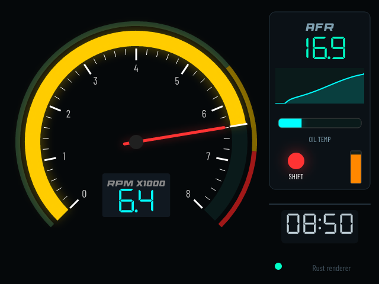

# GaugeDotnet — Rust renderer

A Rust port of GaugeDotnet's rendering stack. It loads the same `custom-gauge.json` files the Avalonia designer saves, and the same `gauges.json` screen list. It draws them on the CPU with [tiny-skia](https://github.com/RazrFalcon/tiny-skia), and the frames can be shown in an SDL2 window or saved as PNG.



## Layout

| Crate | Purpose |
|-------|---------|
| `gauge-render` | Library: canvas, fonts, the 17 custom element renderers, calculated channels, the 8 built-in gauges and the `gauges.json` factory |
| `gauge-app` | `gauge` binary: PNG snapshots, a benchmark and an optional SDL2 window, all driven by a port of `SimulatedMeDevice` |

### C# → Rust map

| C# | Rust |
|----|------|
| `Gauges/Custom/GaugeElement.cs` | `model.rs` (serde, the same `$type` names and PascalCase properties) |
| `Gauges/Custom/ElementRenderer.cs` + `Renderers/*` | `custom/renderer.rs` (`ElementRenderer`) |
| `Gauges/Custom/CustomGauge.cs` | `custom/gauge.rs` (frame-rate independent smoothing) |
| `Gauges/Custom/ExpressionEvaluator.cs` | `expression.rs` |
| `ImageCache` / `GifCache` | `images.rs` (PNG, JPEG, WebP, plus GIF/APNG/WebP animation frames) |
| `Rendering/FontHelper.cs` | `text.rs` (the four bundled fonts are embedded in the binary) |
| `BaseGauge`, `BarGauge`, `CircularGauge`, `NeedleGauge`, `SweepGauge`, `DigitalGauge`, `MinMaxGauge`, `HistogramGauge`, `GridGauge`, `SegmentDisplay` | `gauges/*.rs` |
| `GaugeFactory`, `AppConfig`, `GaugeConfig`, `TolerantGaugeTypeConverter` | `gauges/mod.rs`, `gauges/config.rs` |
| `SKCanvas` / `SKPaint` / `SKMaskFilter` | `canvas.rs` (save/restore, transforms, clips, `SaveLayer` opacity, arcs, round rects, text, normal and outer blur) |
| `value.ToString("F1")`, `DateTime.ToString("HH:mm")` | `format.rs` (standard and custom .NET numeric and date format strings, invariant culture) |
| `SimulatedMeDevice` | `gauge-app/src/sim.rs` |
| `GaugeSDL` / `GameLoop` | `gauge-app/src/window.rs` |

## Build and run

```shell
cd rust
cargo test                                    # unit + render tests
cargo run --release -- render examples/showcase.json -o out.png
cargo run --release -- render examples/gauges.json -o screen.png     # one PNG per screen
cargo run --release -- render my-gauge.json --set Rpm=6500 --set OilTemp=104
cargo run --release -- builtin needle --value 72 --title SPEED --unit KMH --color '#FF8800'
cargo run --release -- bench examples/showcase.json                  # values change every frame
cargo run --release -- bench examples/showcase.json --data-hz 20     # realistic ECU rate
cargo run --release -- bench examples/showcase.json --full --threads 1  # worst case

# Live window (needs libsdl2-dev). Left/Right or the D-pad switch screens; Esc quits.
cargo run --release --features sdl -- run examples/gauges.json
```

Relative paths inside a definition (images, needle images, GIFs) resolve against the JSON file's folder, as in the C# app.

### Using the library

```rust
use gauge_render::{Canvas, CustomGauge};

let mut gauge = CustomGauge::load("custom-gauge.json")?;
let mut canvas = Canvas::new(640, 480);
loop {
    gauge.update_from(|source| ecu.read(source)); // e.g. "Rpm", "OilTemp"
    let damage = gauge.draw(&mut canvas);         // smooths, then repaints only what changed
    for r in &damage.rects {
        upload(canvas.pixmap(), r);               // RGBA8, premultiplied (opaque frames)
    }
}
```

`draw` assumes the canvas still holds the previous frame. After anything
else draws on it (switching screens, an overlay), call
`gauge.invalidate()` so the next frame is repainted in full.

### Cross-compiling for the RG35XX (aarch64)

```shell
rustup target add aarch64-unknown-linux-gnu
sudo apt install gcc-aarch64-linux-gnu
CARGO_TARGET_AARCH64_UNKNOWN_LINUX_GNU_LINKER=aarch64-linux-gnu-gcc \
  cargo build --release --target aarch64-unknown-linux-gnu -p gauge-app
```

That produces a headless build: `render` and `bench` work, but there is no window. The SDL window (`--features sdl`) also needs the device's `libSDL2` to link against, from a sysroot or by building on the device. The headless aarch64 binary has been checked under `qemu-aarch64`, and its output matches the x86 build pixel for pixel.

## Performance

Everything is rasterised on the CPU. Glows are the expensive part, so:
- **Large blurs run downscaled:** sigmas of 3 or more are blurred on a 2× or 4× smaller buffer and upscaled bilinearly, the way Skia's GPU backend does.
- **Glows are alpha-only:** each glow is one colour, so only its coverage (A8) is rasterised and blurred, then composited with that colour.
- **Static content is cached as trimmed `Sprite`s.** The built-in gauges cache their backgrounds, lit segments (keyed by count and colour), segment-display digits (keyed by text and colour) and Histogram bars (keyed by sample version). Custom gauges pre-render each run of static elements, together with the background.
- **Opacity layers composite only the area that was drawn into.**

Custom gauges also redraw incrementally, using several cores (`ElementRenderer::render_incremental`, which `CustomGauge::draw` uses):
- **Damage tracking:** each dynamic element is fingerprinted every frame (its value, or its clock text, peak or graph history). Only regions touched by changed elements are repainted, and their rects are returned so the window uploads just those to the texture. A moving arc or bar fill only damages the wedge or strip between its old and new value.
- **Tiles:** each damaged rect is re-rendered from the full draw list into a small tile canvas and pasted in. Large rects are split into bands, and all tiles are shared out over up to 4 threads (`CustomGauge::set_threads`).
- **Exact by construction:**
  - Paths are flattened to line segments in device space, so tiles clip them consistently.
  - Arcs are built from fixed 15° segments, so a growing arc leaves its old pixels unchanged.
  - Blur grids are aligned to frame coordinates.
  - Tests check that incremental and threaded frames match a full render.

`bench examples/showcase.json` (19 elements covering 15 of the 17 element types, with glows), desktop x86 core:

| Situation | 1 thread | 4 threads | Repainted |
|---|---:|---:|---:|
| Full repaint (screen switch, `--full`) | 2.24 ms | 1.46 ms | 100 % |
| Values gliding (new data every frame) | 1.36 ms | 0.96 ms | 26 % |
| Values gliding (20 Hz data) | 1.36 ms | 1.03 ms | 25 % |
| Values settled (only the graph scrolls) | 0.09 ms | 0.08 ms | 3 % |

The C# renderer takes 8.7 ms for a full frame on the same CPU; see [`bench/`](../bench/README.md). Measure on the RG35XX's Cortex-A53 with `gauge bench`.

## Differences from the C# renderer

- **CPU rendering** instead of Skia on GLES2. Antialiasing and blur falloff differ slightly: the gaussian is approximated with three box blurs.
- **Calculated-channel inputs are tracked.** The C# `CustomGauge` only polls sources bound directly to an element, so `Rpm / 1000` read 0 unless some element also used `Rpm`. Visibility sources are tracked too.
- **Invalid colours render black** instead of throwing from `SKColor.Parse`. Likewise, the `D`/`X` number formats render a rounded integer, where .NET would throw for a float.
- **No global state.** Graph history, peak-hold values and image caches live in each `ElementRenderer`, not in static dictionaries.
- `GraphElement.HistoryDepth` below 2 is treated as 2. In C# it divides by zero.

Not ported, because they are outside the renderer: BLE and CAN decoding (`ME1_4NET`), the Avalonia designer, the on-device config editor, splash, battery and error overlays, and gamepad input.
