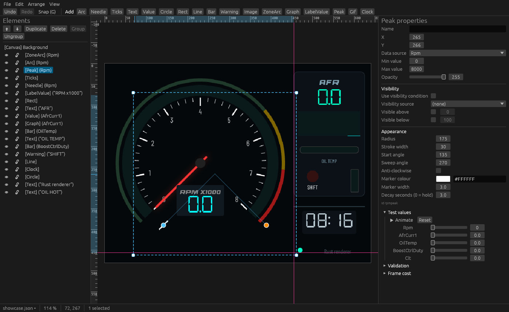

# GaugeDotnet — Rust renderer

A Rust port of GaugeDotnet's rendering stack. It loads the same `custom-gauge.json` files the designers save, and the same `gauges.json` screen list. It draws them on the CPU with [tiny-skia](https://github.com/RazrFalcon/tiny-skia), and the frames can be shown in an SDL2 window or saved as PNG. It also has its own [gauge designer](#gauge-designer), which previews with this renderer.


## Layout

| Crate | Purpose |
|-------|---------|
| `gauge-render` | Library: canvas, fonts, the 17 custom element renderers, calculated channels, the 9 built-in gauges and the `gauges.json` factory |
| `me-data` | ECU data: CAN frame decoding ME1_1–ME1_8 (port of `ME1_4NET`, with all its tests), `MeData`, data-source names (`DataSourceMapper`) and the RaceChrono BLE packet format |
| `me-ble` | Bluetooth link to the ECU on btleplug (port of `BleManager`, `MeDevice` and `BluetoothHardwareInit`), with a synchronous `BleLink` handle for render loops |
| `gauge-app` | `gauge` binary: PNG snapshots, a benchmark, an optional SDL2 window, and Bluetooth tools. Fed by a port of `SimulatedMeDevice` or by the ECU |
| `gauge-designer` | `gauge-designer` binary: the desktop gauge designer (egui), a port of the Avalonia designer plus the improvements in [Gauge designer](#gauge-designer) |

### C# → Rust map

| C# | Rust |
|----|------|
| `Gauges/Custom/GaugeElement.cs` | `model.rs` (serde, the same `$type` names and PascalCase properties) |
| `Gauges/Custom/ElementRenderer.cs` + `Renderers/*` | `custom/renderer.rs` (`ElementRenderer`) |
| `Gauges/Custom/CustomGauge.cs` | `custom/gauge.rs` (frame-rate independent smoothing) |
| `Gauges/Custom/ExpressionEvaluator.cs` | `expression.rs` |
| `ImageCache` / `GifCache` | `images.rs` (PNG, JPEG, WebP, plus GIF/APNG/WebP animation frames) |
| `Rendering/FontHelper.cs` | `text.rs` (the bundled fonts are embedded in the binary) |
| `BaseGauge`, `BarGauge`, `CircularGauge`, `NeedleGauge`, `TurboXsGauge`, `SweepGauge`, `DigitalGauge`, `MinMaxGauge`, `HistogramGauge`, `GridGauge`, `SegmentDisplay` | `gauges/*.rs` |
| `GaugeFactory`, `AppConfig`, `GaugeConfig`, `TolerantGaugeTypeConverter` | `gauges/mod.rs`, `gauges/config.rs` |
| `SKCanvas` / `SKPaint` / `SKMaskFilter` | `canvas.rs` (save/restore, transforms, clips, `SaveLayer` opacity, arcs, round rects, text, normal and outer blur) |
| `value.ToString("F1")`, `DateTime.ToString("HH:mm")` | `format.rs` (standard and custom .NET numeric and date format strings, invariant culture) |
| `ME1_4NET` (`CanDecoder`, `Frames/*`, `MEData`), `DataSourceMapper` | `me-data` |
| `BleManager`, `MeDevice`, `RaceChronoIds` | `me-ble/src/device.rs`, `me-data/src/racechrono.rs` |
| `RG35XX.Libraries/BluetoothHardwareInit` | `me-ble/src/hardware.rs` |
| `SimulatedMeDevice` | `gauge-app/src/sim.rs` |
| `Program`, `GameLoop`, `GaugeSDL` | `gauge-app/src/app.rs`, `display.rs` (the `run` viewer is `window.rs`) |
| `ConfigEditor` | `gauge-app/src/editor.rs` |
| `SplashScreen`, `ErrorScreen`, `FpsCounter`, `BatteryOverlay`, `ScreenKeepAlive` | `gauge-app/src/screens.rs` |
| `GamePads`, `LinuxGamePadReader`, `KeyBus`, `InputHandler` | `gauge-app/src/input.rs` |
| `GaugeDotnet.Designer` (`MainWindow`, `GaugeDesignerViewModel`) | `gauge-designer/src/app.rs`, `document.rs` |
| `Designer/Rendering/ElementRenderer.cs` (`GetBounds`, `HitTest`, `SetBounds`) | `gauge-designer/src/geometry.rs` |

## Build and run

```shell
cd rust
cargo test                                    # unit + render tests
cargo run --release -- render examples/showcase.json -o out.png
cargo run --release -- render examples/gauges.json -o screen.png     # one PNG per screen
cargo run --release -- render my-gauge.json --set Rpm=6500 --set OilTemp=104
cargo run --release -- builtin needle --value 72 --title SPEED --unit KMH --color '#FF8800'
cargo run --release -- builtin turboxs --value 0.4 --min -10 --max 20 --title 'Boost Press.' --unit Psi --decimals 1
cargo run --release -- bench examples/showcase.json                  # values change every frame
cargo run --release -- bench examples/showcase.json --data-hz 20     # realistic ECU rate
cargo run --release -- bench examples/showcase.json --full --threads 1  # worst case

# Live window (needs libsdl2-dev). Left/Right or the D-pad switch screens; Esc quits.
cargo run --release --features sdl -- run examples/gauges.json
```

Relative paths inside a definition (images, needle images, GIFs) resolve against the JSON file's folder, as in the C# app.

### The device app

`gauge app` is the port of the C# `Program` and `GameLoop`:
1. It loads `gauges.json` (by default the one next to the binary; `--config` picks another). If the file is missing, it writes the same default as the C# app, a Bar gauge for AFR, and only the first 10 screens are kept.
2. It shows the splash screen while Bluetooth comes up and the ECU connects. In `DemoMode`, or with `--demo`, it uses simulated data instead.
3. It runs the screens. The FPS counter and the low-battery icon are drawn over them, and MuOS is kept from sleeping.
4. When you quit, it plays the exit animation.

If the connection fails, the error screen stays up until any button is pressed.

```shell
cargo run --release --features sdl -- app --demo                 # desktop, simulated data
cargo run --release --features sdl,ble -- app --config my.json    # desktop, real ECU
```

Controls (the gamepad is read from `/dev/input/js0`, as in the C# release build; without one, the keyboard is used):

| Button | Key | Action |
|---|---|---|
| D-pad left / right | ← / → | previous / next screen (wraps around) |
| R1 | `.` or `r` | reset the screen's peaks and history |
| MENU | Esc | quit |
| SELECT | Tab | open the config editor |

**Config editor**, a port of the C# `ConfigEditor`, has three pages:
- **Screens:** the screen list. A edits the highlighted screen, the last row adds a screen (up to 10), and X deletes one (the last screen can't be deleted).
- **Gauge settings:** one row per setting of the gauge type. LEFT/RIGHT cycles the value (type, data source, title, colour, min/max, decimals, segments, smoothing, …). On a Grid gauge, A opens a cell.
- **Grid cell:** data source, title, unit and decimals.

START saves `gauges.json`, and B goes back a page. Leaving the editor with B saves any unsaved edits and rebuilds the screens. Saves are atomic (temp file, fsync, rename), and a config that can't be parsed is kept as `gauges.json.bad` before the defaults replace it. With no gamepad, use the arrows, `z` for A, Escape/`x` for B, Return/`s` for START and Delete/Backspace for X (the C# app had no keyboard key for X).

On the RG35XX the Bluetooth bring-up (`rtk_hciattach`, `bluetoothd`) runs automatically when `rtk_hciattach` exists. Force it with `--init-bt` or skip it with `--no-init-bt`.

### Building and deploying to the RG35XX

```shell
./build-arm64.sh          # -> target/aarch64-unknown-linux-gnu/release/gauge
./deploy-arm64.sh         # build, then scp to the device (REMOTE_HOST, REMOTE_PASS, ... as in ../deploy-arm64.sh)
SKIP_BUILD=1 ./deploy-arm64.sh   # upload the existing build only
```

**Without a cross toolchain:** when `aarch64-linux-gnu-gcc` isn't installed, or with `USE_DOCKER=1`, `build-arm64.sh` runs itself in a `rust:1-bookworm` container, so Docker is the only requirement. That build targets glibc 2.36. The cargo registry is cached in the `gauge-cargo-registry` Docker volume.

**Login:** `deploy-arm64.sh` uses `sshpass` with `REMOTE_PASS` when `sshpass` is installed. Otherwise it uses plain `ssh` and `scp`, which need your key on the device: run `ssh-copy-id root@<host>` once.

`build-arm64.sh` cross-compiles with `--features sdl,ble-vendored`. It needs the `aarch64-unknown-linux-gnu` rustup target, `gcc-aarch64-linux-gnu`, `curl` and `dpkg-deb`. On first use it fetches the arm64 `libSDL2` from Ubuntu's archive to link against. At run time the binary uses the device's own `libSDL2-2.0.so.0`, as the C# app does, and libdbus is compiled in. So the only thing installed is a single 5 MB `gauge` binary.

`deploy-arm64.sh` copies the binary to `/mnt/mmc/ports/GaugeRust`, separate from the C# app, and copies the launcher `GaugeRust.sh` to `/mnt/mmc/roms/ports`, so it shows up under Ports. `gauges.json` lives next to the binary. Copy over the C# one, or use `UPLOAD_CONFIG=1` to upload `./gauges.json`. The log is `GaugeRust.log` in the same folder. It also uploads the Ports-list artwork (`../muos/GaugeRust.png` and `.txt`) to muOS's `External - Ports` catalogue.

**glibc:** the device (muOS) has **glibc 2.38**, and the binary needs no newer glibc than the one it was linked against. A host cross toolchain links against the host's glibc (Arch's is 2.4x), so the binary won't start on the device (`GLIBC_2.39' not found`). Ways to build for an older glibc:

- **zig (no Docker):** install `zig` and `cargo-zigbuild` (Arch: `pacman -S zig cargo-zigbuild`, or `cargo install cargo-zigbuild`). `build-arm64.sh` then uses `cargo zigbuild` automatically and targets glibc 2.36 (`GLIBC=2.38` to change it, `USE_ZIG=0` to skip it). The output path is the same.
- **Docker:** `USE_DOCKER=1 ./build-arm64.sh` (glibc 2.36, see above).

Check the device with `ldd --version`.

### Bluetooth (ECU)

Build with `--features ble`, which needs `libdbus-1-dev`; `ble-vendored` compiles libdbus in instead:

```shell
cargo run --release --features ble -- ble-scan                     # list nearby ME devices
cargo run --release --features ble -- ble-monitor --mac 20:E7:C8:B9:20:2A   # print live values
cargo run --release --features sdl,ble -- run examples/gauges.json --ble    # gauges from the ECU
```

`run --ble` takes the MAC from `--mac`, or else from `DeviceMacAddress` in `gauges.json`. Without either, it uses the first device advertising the RaceChrono service. On the RG35XX, add `--init-bt`: it runs the controller and BlueZ bring-up the C# app does at startup (`rtk_hciattach`, `bluetoothd`, clearing stale links) and clears BlueZ's cache for the MAC. While the ECU isn't connected, a banner shows the state (searching, reconnecting, or the error message). The link reconnects on its own, with a 1–10 s backoff, and re-subscribes after every reconnect.

### Using the library

```rust
use gauge_render::{Canvas, CustomGauge};

let mut gauge = CustomGauge::load("custom-gauge.json")?;
let mut canvas = Canvas::new(640, 480);
loop {
    gauge.update_from(|source| ecu.read(source)); // e.g. "Rpm", "OilTemp"
    let damage = gauge.draw(&mut canvas);         // smooths, then repaints only what changed
    for r in &damage.rects {
        upload(canvas.pixmap(), r);               // RGBA8, premultiplied (opaque frames)
    }
}
```

`draw` assumes the canvas still holds the previous frame. After anything
else draws on it (switching screens, an overlay), call
`gauge.invalidate()` so the next frame is repainted in full.

### Cross-compiling for the RG35XX (aarch64)

```shell
rustup target add aarch64-unknown-linux-gnu
sudo apt install gcc-aarch64-linux-gnu
CARGO_TARGET_AARCH64_UNKNOWN_LINUX_GNU_LINKER=aarch64-linux-gnu-gcc \
  cargo build --release --target aarch64-unknown-linux-gnu -p gauge-app
```

(`build-arm64.sh` above does the full device build.) Built like this, without features, the binary is headless: `render` and `bench` work, but there is no window. Add `--features ble-vendored` for the Bluetooth tools (`ble-scan`, `ble-monitor`). libdbus is then compiled into the binary, so it needs nothing on the device beyond libc; set `CC_aarch64_unknown_linux_gnu=aarch64-linux-gnu-gcc` as well. The SDL window (`--features sdl`) also needs the device's `libSDL2` to link against, from a sysroot or by building on the device. The headless aarch64 binary has been checked under `qemu-aarch64`, and its output matches the x86 build pixel for pixel.

## Gauge designer



`gauge-designer` edits custom gauge definitions. Its canvas is drawn by `gauge-render`, so at 100 % zoom what you see is what the RG35XX shows, pixel for pixel: blur, antialiasing, image sampling and round-rect corners included. Files are the same JSON as the Avalonia designer's, both ways.

```shell
cd rust
cargo run --release -p gauge-designer                          # starts with the RPM dial
cargo run --release -p gauge-designer -- my-gauge.json         # open a gauge
cargo run --release -p gauge-designer -- --config gauges.json  # also open the screen list
```

It runs on Linux, Windows and macOS. On Linux it needs OpenGL 2 (Mesa is fine) and, on X11, `libxkbcommon-x11`. Use `--release`: the debug build renders slowly and its frame-cost numbers are meaningless.

**What the C# designer did, ported:**
- toolbox for all 17 element types
- click to select, Ctrl/Shift multi-select, drag to move, corner handles to resize, arrows nudge 1 px (Shift: 10 px), `G` grid snap
- element list with `[Canvas] Background`, draw order, duplicate and delete
- a property panel per element type, background settings and calculated channels
- test-value sliders for every bound source
- undo/redo, New / Open / Save
- on save, images are copied into `images/` next to the JSON: stills are re-encoded to `image_N.png`, GIF/APNG/WebP animations are copied byte for byte, and paths become relative

**Beyond the C# designer:**
- **Editing:** copy/cut/paste as JSON (also between files and designer windows), group/ungroup, lock and hide per element (kept in `<name>.designer.json` next to the gauge, so gauge files stay what the device reads), and marquee selection.
- **Arrange:** align left/centre/right/top/middle/bottom, centre on canvas, distribute, bring to front / send to back. Smart guides snap to the edges and centres of other elements and of the canvas (hold Alt to bypass).
- **View:** zoom and pan, rulers, and a grid of any size.
- **Angle handles** on arcs, zone arcs, peak markers, tick rings and needles: one rotates the sweep, the other sets where it ends. Images and GIFs get a rotation handle. Shift snaps to 15°.
- **Named undo:** "Undo Move Arc", "Undo Change Colour of Arc 'RPM Arc'". Repeated edits of one property merge into one step, and Edit → Show history lists the steps.
- **Validation panel:** colours that render black, unknown data sources, calculated channels that don't parse or use unknown names, missing image files, number and clock formats the device formatter handles differently from .NET, empty ranges, duplicate ids. Click an entry to select the element.
- **Frame cost:** times every element with the real renderer, each on a fresh thread so glow caching can't hide the cost of a changing value. It shows the full-repaint and per-frame totals with an RG35XX estimate (×3.7, the median ratio of the built-in screens in [`bench/RESULTS.md`](../bench/RESULTS.md)) against the 60 fps budget.
- **Device preview:** the FPS counter, the low-battery icon, and an approximation of the TurboXs LCD look. The `▶ Animate` button sweeps every value.
- **Screens (`gauges.json`):** File → Screens edits the screen list, each built-in gauge's settings and grid cells, with a live preview of every screen. Custom screens open in the designer. Saves are atomic.
- **Deploy to device:** File → Deploy uploads the gauge and its images over ssh/scp, with the `REMOTE_HOST`, `REMOTE_USER`, `REMOTE_PASS` and `BIN_DIR` defaults of `deploy-arm64.sh`. Screens → Upload copies `gauges.json`. The app reads files at start-up, so restart it on the device.
- **Templates and snippets:** File → New starts from a blank canvas or one of four starting points modelled on the built-in screens (RPM dial, needle dial, bar, 2×2 grid). File → Save selection as snippet / Insert snippet reuse groups of elements.
- **Export:** PNG of the current frame, or an animated GIF of every value sweeping min → max → min.

| Key | Action |
|---|---|
| Ctrl+Z / Ctrl+Y (Ctrl+Shift+Z) | undo / redo |
| Ctrl+C / Ctrl+X / Ctrl+V / Ctrl+D | copy / cut / paste / duplicate |
| Delete, Backspace | delete the selection |
| Ctrl+A, Escape | select all, select none |
| Ctrl+G / Ctrl+Shift+G | group / ungroup |
| Ctrl+L / Ctrl+H | lock / hide (toggle) |
| Arrows, Shift+arrows | nudge 1 px / 10 px |
| G | grid snap on/off |
| Shift while dragging | move along one axis; snap angles to 15° |
| Alt while dragging | no grid or guide snapping |
| Ctrl+wheel, pinch | zoom about the pointer |
| Wheel, middle drag, Space+drag | pan |
| Ctrl+0 / Ctrl+1 | fit / 100 % |
| Ctrl+N / Ctrl+O / Ctrl+S / Ctrl+Shift+S | new / open / save / save as |

## Performance

Everything is rasterised on the CPU. Glows are the expensive part, so:
- **Large blurs run downscaled:** sigmas of 3 or more are blurred on a 2× or 4× smaller buffer and upscaled bilinearly, the way Skia's GPU backend does.
- **Glows are alpha-only:** each glow is one colour, so only its coverage (A8) is rasterised and blurred, then composited with that colour.
- **Static content is cached as trimmed `Sprite`s.** The built-in gauges cache their backgrounds, lit segments (keyed by count and colour), segment-display digits (keyed by text and colour) and Histogram bars (keyed by sample version). Custom gauges pre-render each run of static elements, together with the background.
- **Opacity layers composite only the area that was drawn into.**
- **Glow coverage is memoised:** the blurred low-res coverage of each glow is cached per rendering thread (up to 4 MB), keyed on the exact low-res path, size and blur. A hit gives exactly the bytes a fresh render would, and scrolling histogram bars, ring segments and digits hit almost every time. Only the part of a glow whose coverage is non-zero is upscaled and blended.
- **Hot loops vectorise on aarch64:** the blends and the upscale in `composite.rs` are branch-free 16-bit loops, so they run 8–16 pixels per instruction with NEON. The upscale is separable and polyphase for the 2× and 4× scales, and streams each row straight into the blend. Axis-aligned rectangles skip tiny-skia's per-row supersampling for their whole-pixel interior. All of this is exact; tests compare it with the straightforward code and with tiny-skia.

Custom gauges also redraw incrementally, using several cores (`ElementRenderer::render_incremental`, which `CustomGauge::draw` uses):
- **Damage tracking:** each dynamic element is fingerprinted every frame (its value, or its clock text, peak or graph history). Only regions touched by changed elements are repainted, and their rects are returned so the window uploads just those to the texture. A moving arc or bar fill only damages the wedge or strip between its old and new value.
- **Tiles:** each damaged rect is re-rendered from the full draw list into a small tile canvas and pasted in. Large rects are split into bands, and all tiles are shared out over up to 4 threads (`CustomGauge::set_threads`).
- **Exact by construction:**
  - Paths are flattened to line segments in device space, so tiles clip them consistently.
  - Arcs are built from fixed 15° segments, so a growing arc leaves its old pixels unchanged.
  - Blur grids are aligned to frame coordinates.
  - Tests check that incremental and threaded frames match a full render.

`bench examples/showcase.json` (19 elements covering 15 of the 17 element types, with glows), desktop x86 core:

| Situation | 1 thread | 4 threads | Repainted |
|---|---:|---:|---:|
| Full repaint (screen switch, `--full`) | 2.24 ms | 1.46 ms | 100 % |
| Values gliding (new data every frame) | 1.36 ms | 0.96 ms | 26 % |
| Values gliding (20 Hz data) | 1.36 ms | 1.03 ms | 25 % |
| Values settled (only the graph scrolls) | 0.09 ms | 0.08 ms | 3 % |

The C# renderer takes 8.7 ms for a full frame on the same CPU; see [`bench/`](../bench/README.md).

On the RG35XX (Cortex-A53 at 1.5 GHz, `gauge bench examples/gauges.json`, new data every frame), ms/frame before and after the aarch64 work described in [`bench/RESULTS.md`](../bench/RESULTS.md#5-on-the-device-rg35xx):

| Screen | Before | After |
|---|---:|---:|
| Custom (showcase.json) | 6.5 | 4.5 |
| Circular | 16.1 | 7.6 |
| Needle | 5.1 | 2.6 |
| Sweep | 11.7 | 5.3 |
| Bar | 4.8 | 2.9 |
| Digital | 5.5 | 3.2 |
| MinMax | 8.7 | 4.5 |
| Histogram (`IntervalMs` 0) | 37.0 | 9.4 |
| Grid | 3.0 | 3.0 |
| TurboXs / with `"Lcd": true` | 4.4 / 4.7 | 4.4 / 4.6 |

Every screen now holds 60 fps with room to spare. The frames are byte-identical before and after, on x86 and on the device.

## Differences from the C# renderer

- **Unknown data sources no longer crash the update loop.** In C#, `CustomGauge.UpdateFromDevice` asks `DataSourceMapper.ReadValue` for every bound source, and that throws for names it doesn't know. So an element bound to a calculated channel such as `RpmK` threw on the device. Here unknown names just aren't fed, and calculated channels are computed from their inputs.

- **CPU rendering** instead of Skia on GLES2. Antialiasing and blur falloff differ slightly: the gaussian is approximated with three box blurs.
- **Calculated-channel inputs are tracked.** The C# `CustomGauge` only polls sources bound directly to an element, so `Rpm / 1000` read 0 unless some element also used `Rpm`. Visibility sources are tracked too.
- **Invalid colours render black** instead of throwing from `SKColor.Parse`. Likewise, the `D`/`X` number formats render a rounded integer, where .NET would throw for a float.
- **Config editor fixes:**
  - On a keyboard, Escape leaves the editor without also quitting the app. In C# it is both B and MENU.
  - Delete/Backspace act as X.
  - Saving writes to the `gauges.json` the app loaded, and shows "Save failed!" if it can't.
- **Key releases don't delay presses.** A quick tap (a press and release in the same frame) no longer holds back the next button by a frame.
- **No global state.** Graph history, peak-hold values and image caches live in each `ElementRenderer`, not in static dictionaries.
- `GraphElement.HistoryDepth` below 2 is treated as 2. In C# it divides by zero.

Everything the device runs is ported, and so is the Avalonia designer (`gauge-designer`). Small helpers the Rust app has no use for (`AppLauncher`, `StorageProvider`, `DeviceInfo`) are not ported.

The Bluetooth link builds and handles errors, but it hasn't run against a real ECU yet: this environment has no Bluetooth controller. Before relying on it, check it on the device with `gauge ble-monitor --init-bt`.
